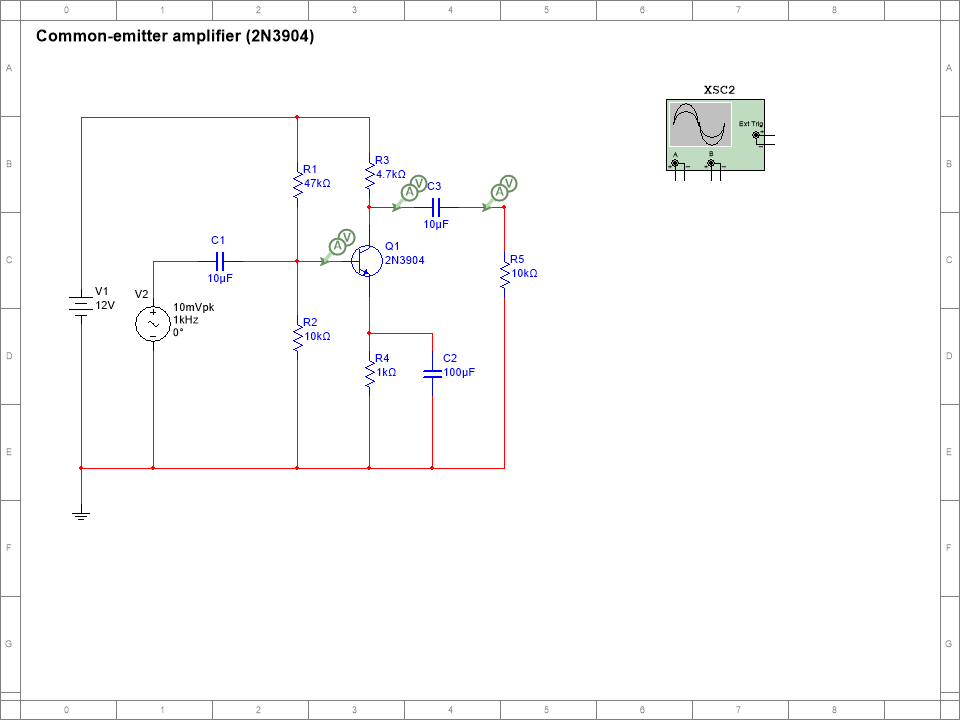
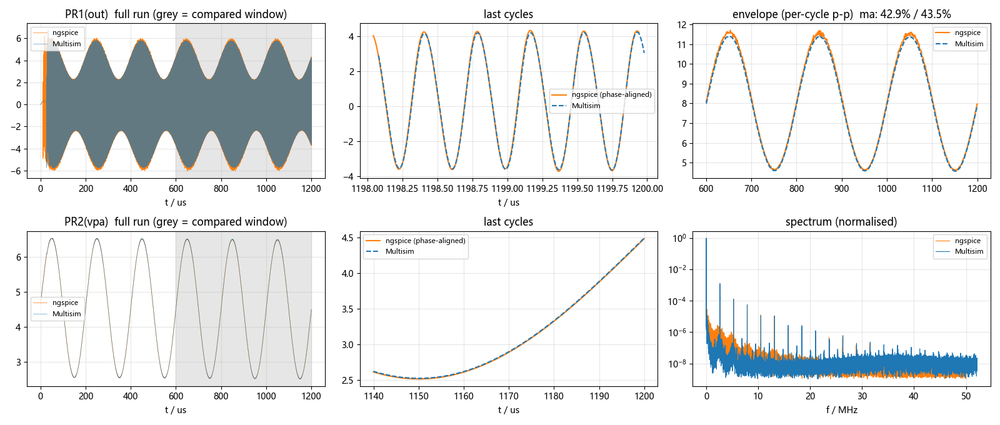

# Multisim-Agent

**Let an AI agent draw correct, tidy NI Multisim schematics — and prove they are correct.**

[中文说明](README.zh-CN.md)

Multisim has no public file format and no placement API, so agents usually give up and hand you a SPICE netlist
to import (parts dumped in a heap, wires everywhere). This skill lets an agent write a real `.ms14` file: parts on a
grid, orthogonal wires, junction dots, probes, an oscilloscope and sensible simulation settings — then verifies it
with Multisim itself and an independent ngspice run before anything is handed over.

| | |
|---|---|
|  |  |
| generated schematic, opened by Multisim | verification: Multisim (dashed) vs ngspice for a 50-part AM transmitter |

## Why trust the output

`msa check` refuses to pass a design unless every layer agrees:

| layer | checked |
|---|---|
| lint | geometry: no diagonal wires, nothing through part bodies, no overlapping wires, no wire end resting on another wire without a junction (looks connected, isn't), probes on wires, on-grid, on-sheet |
| A | Multisim opens the file, and **Multisim's own netlist** equals your reference netlist (ground-anchored, polarity-aware) |
| B | every R/C/L/source value equals the reference |
| C | the simulation settings stored in the file are fine enough for the signal (a default "calculate" step garbles RF/AM waveforms in the user's Transient analysis — the automated simulation can't see that, so it is checked statically) |
| D | DC operating point: Multisim vs ngspice at every probe |
| E | transient: DC level, peak-to-peak, frequency, envelope / modulation index / envelope shape, Multisim vs ngspice |

The test-suite builds four circuits (RC network, common-emitter amplifier, 2.63 MHz oscillator, 50-part AM
transmitter) that must pass, and three deliberately broken ones (reversed source, wrong value, missing time-step
setting) that must fail in the right layer.

## Requirements

- Windows with **NI Multisim 14.x** (tested on 14.3) — the samples that ship with it are used as part templates.
- **Python 3.8+** with `numpy` and `matplotlib`.
- **ngspice** (Windows build; `ngspice_con.exe`) — the independent reference simulator.
- .NET Framework 4 (present on every Windows 10/11) — compiles two tiny 32-bit COM helpers locally.

## Install

The repository root *is* the skill folder (`SKILL.md` + `scripts/`).

**Claude Code (plugin, one step):**

```
/plugin install multisim-agent --marketplace Allyx890/Multisim-Agent
```

(older Claude Code: `/plugin marketplace add Allyx890/Multisim-Agent`, then `/plugin install multisim-agent@multisim-agent`)

**As a plain skill (Claude Code or any agent that reads SKILL.md):**

```bash
git clone https://github.com/Allyx890/Multisim-Agent ~/.claude/skills/multisim-agent   # folder name must be multisim-agent
```

Then, once per machine (`<skill>` = where it was installed; the agent can do this for you):

```bash
python <skill>/scripts/msa.py doctor   # what's missing and how to fix it
python <skill>/scripts/msa.py setup    # one-time: unpack samples, compile helpers
python <skill>/scripts/msa.py selftest # optional: full self-test (~3 min)
```

Paths are auto-detected; override with `MULTISIM_DIR`, `MULTISIM_SAMPLES`, `NGSPICE`, `MULTISIM_AGENT_CACHE`.

## Use

Ask your agent for a circuit "in Multisim". Under the hood it follows the golden path in [SKILL.md](SKILL.md):

```bash
msa new amp --dir work            # amp.cir (reference netlist) + amp.py (layout script), runnable as-is
# write amp.cir, simulate it in ngspice; lay it out in amp.py (msa parts shows pin offsets)
msa check work/amp.py --cir work/amp.cir --tran 10e-3 --dt 5e-6 --deliver out/
```

`msa` = `python scripts/msa.py`. Examples with build script, reference netlist and models live in
[`examples/`](examples). Other commands: `parts`, `models`, `lint`, `verify`, `render`, `sim`, `simset`
(inspect/fix the simulation settings of any `.ms14`), `unpack`/`pack`.

## How it works

`.ms14` is PKWARE-DCL-compressed XML (pure-Python codec in `scripts/ms14.py`). Parts are cloned from Multisim's own
sample circuits with all internal ids renewed; wires, junctions and probes are generated; Multisim rebuilds
connectivity from the wires when it loads the file. Verification drives Multisim through its COM automation
interface (32-bit helpers compiled on your machine). Format notes: [references/format.md](references/format.md);
the story of every pitfall: [references/lessons.md](references/lessons.md).

## Contributing

New part types are the most useful contribution: find an instance with `python scripts/tplfind.py <family>`, add it
to `TPL` in `scripts/msgen.py`, add a small circuit to `tests/test_circuits.py`, and make `msa selftest` pass.
Please keep `references/lessons.md` growing — symptom, cause, fix.

## Notes

Not affiliated with or endorsed by National Instruments / Emerson. Multisim is a trademark of its owner. No NI
files are redistributed: templates are read from your own Multisim installation. The DCL decoder is a port of
Mark Adler's `blast.c` (zlib license); the container layout was first documented in barncastle's
MultiSimConverter gist.

License: [MIT](LICENSE)
