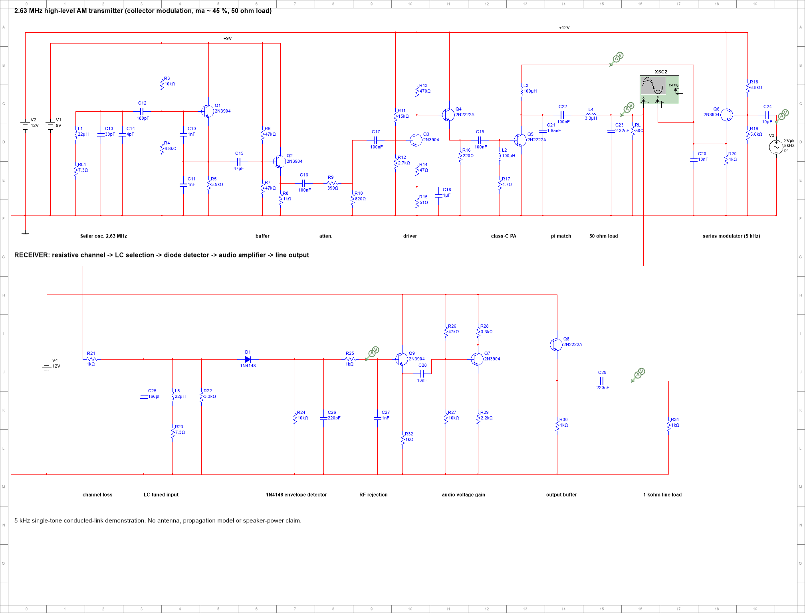
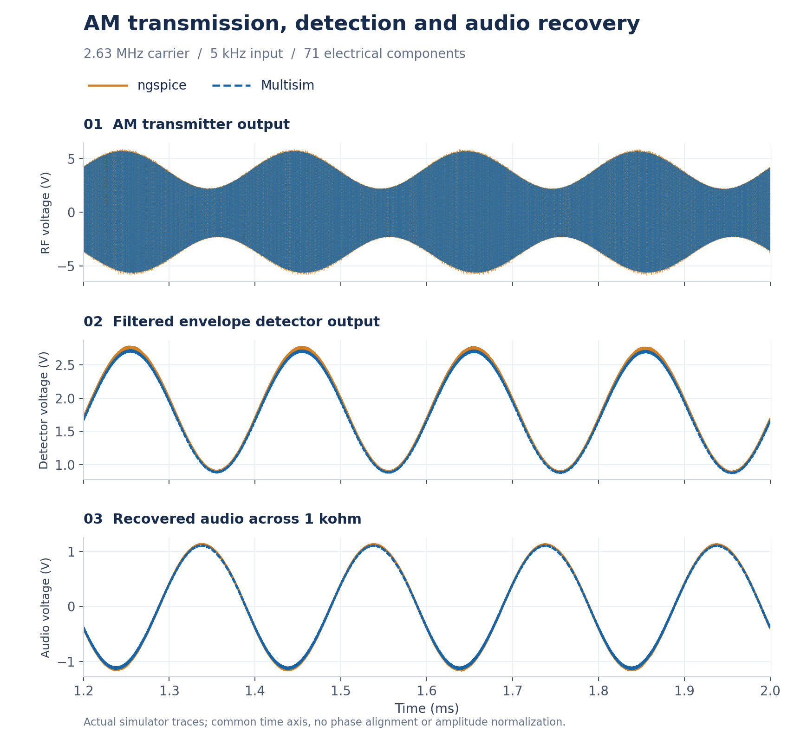

# Multisim-Agent

**让 AI 智能体直接画出正确、规整的 NI Multisim 原理图，并且自己证明它是对的。**

[English](README.md)

Multisim 没有公开的文件格式，也没有摆放元件的接口，所以智能体一般只能给你一份 SPICE 网表让你导入：元件堆成一团，线绕来绕去。
这个技能让智能体直接写出真正的 `.ms14` 文件：元件对齐栅格，导线横平竖直，有连接点、探针、示波器和合理的仿真设置。
交付之前，还会用 Multisim 本身和独立的 ngspice 仿真做核对。

## 主示例：完整 AM 发射与接收链路

**71 个电气元件，一个真正连通的发射机和接收机。** 信号由三极管振荡器产生，经过集电极调幅和电阻衰减通道，再由 LC 选频、二极管包络检波和两级音频电路恢复。这是在原有 50 元件发射机上接入实际接收电路，检波器的输入来自发射机输出。



[生成脚本](examples/am_link/build.py) · [参考网表](examples/am_link/circuit.cir) · [复现说明](examples/am_link/README.md) · [验证报告](docs/examples/am_link_report.md)

在 Multisim 和 ngspice 中分别运行同一电路，比较 5 个探针节点。下图依次显示射频输出、滤波后的检波电压和恢复音频，保留两套仿真的实际电压及时间刻度。



这是 5 kHz 单音、电阻衰减通道、1 kΩ 线路输出的传导链路演示；尚不代表无线距离、扬声器功率或完整语音频段测试。

### 其他示例

| 示例 | 展示的能力 |
|---|---|
| [AM 发射机](examples/am_transmitter) | 50 元件的振荡、推动、丙类功放、匹配网络和集电极调幅 |
| [西勒振荡器](examples/seiler_oscillator) | 高频起振、谐振回路、缓冲与载波测量 |
| [共射放大器](examples/ce_amplifier) | 适合入门的直流偏置、信号耦合与电压放大 |

## 为什么可信

`msa check` 只有在每一层都一致时才判定通过：

| 层 | 检查内容 |
|---|---|
| lint | 几何检查：没有斜线、导线不穿过元件、导线不重叠、没有“看起来连上实际没连”的 T 形接头、探针在导线上、坐标在栅格上、不超出图纸 |
| A | Multisim 能打开文件，并且 **Multisim 自己导出的网表**和你的参考网表一致（以地为锚点，区分极性） |
| B | 每个电阻、电容、电感、电源的数值都和参考网表一致 |
| C | 文件里存的仿真设置对信号来说足够细。默认的 “calculate” 步长会让射频、调幅波形在用户的瞬态分析里画得乱七八糟，而自动仿真察觉不到这个问题，所以单独做静态检查 |
| D | 直流工作点：每个探针处 Multisim 和 ngspice 一致 |
| E | 瞬态：直流分量、峰峰值、频率、包络、调幅指数、包络形状，Multisim 和 ngspice 一致 |

测试套件会生成 5 个必须通过的电路（RC 网络、共射放大器、2.63 MHz 振荡器、AM 发射机、完整 AM 链路），
以及 3 个故意做错的电路（电源接反、数值错、没设时间步长），它们必须在对应的那一层被判 FAIL。

## 环境要求

- Windows + **NI Multisim 14.x**（在 14.3 上测试过）。元件模板取自 Multisim 自带的样例电路。
- **Python 3.8+**，需要 `numpy` 和 `matplotlib`。
- **ngspice**（Windows 版，使用 `ngspice_con.exe`），作为独立的参考仿真器。
- .NET Framework 4（Windows 10/11 自带），用来在本机编译两个很小的 32 位 COM 辅助程序。

## 安装

仓库根目录就是技能目录（`SKILL.md` + `scripts/`）。

**Claude Code（插件方式，一条命令）：**

```
/plugin install multisim-agent --marketplace Allyx890/Multisim-Agent
```

（较老版本的 Claude Code：先 `/plugin marketplace add Allyx890/Multisim-Agent`，再 `/plugin install multisim-agent@multisim-agent`）

**作为普通技能安装（Claude Code 或任何会读 SKILL.md 的智能体）：**

```bash
git clone https://github.com/Allyx890/Multisim-Agent ~/.claude/skills/multisim-agent   # 文件夹名必须是 multisim-agent
```

然后每台电脑做一次初始化（`<技能目录>` 是安装位置；也可以直接让智能体代劳）：

```bash
python <技能目录>/scripts/msa.py doctor   # 检查环境，缺什么、怎么装都会告诉你
python <技能目录>/scripts/msa.py setup    # 一次性初始化：解压样例、编译辅助程序
python <技能目录>/scripts/msa.py selftest # 可选：完整自测（约 3 分钟）
```

路径都是自动探测的，也可以用环境变量 `MULTISIM_DIR`、`MULTISIM_SAMPLES`、`NGSPICE`、`MULTISIM_AGENT_CACHE` 指定。

## 使用

直接让智能体“在 Multisim 里画一个……电路”即可。它会按 [SKILL.md](SKILL.md) 里的标准流程操作：

```bash
msa new amp --dir work            # 生成 amp.cir（参考网表）和 amp.py（版面脚本），可以直接运行
# 写好 amp.cir 并用 ngspice 仿真通过；在 amp.py 里排版（msa parts 列出各元件的引脚偏移）
msa check work/amp.py --cir work/amp.cir --tran 10e-3 --dt 5e-6 --deliver out/
```

`msa` 即 `python scripts/msa.py`。[`examples/`](examples) 里每个示例都包含版面脚本、参考网表和模型库。
其他命令：`parts`、`models`、`lint`、`verify`、`render`、`sim`、`simset`（查看或修复任意 `.ms14` 的仿真设置）、`unpack`/`pack`。

## 原理

`.ms14` 是用 PKWARE DCL 压缩的 XML（纯 Python 编解码，见 `scripts/ms14.py`）。元件从 Multisim 自带样例里整块克隆，所有内部 ID 换新；
导线、连接点、探针由程序生成；Multisim 打开文件时会根据导线重建连接关系。验证通过 Multisim 的 COM 自动化接口完成。
格式说明见 [references/format.md](references/format.md)，所有踩过的坑见 [references/lessons.md](references/lessons.md)。

## 参与贡献

最有用的贡献是增加新的元件类型：用 `python scripts/tplfind.py <器件族>` 找到样例里的实例，加进 `scripts/msgen.py` 的 `TPL`，
再在 `tests/test_circuits.py` 里加一个小电路，确保 `msa selftest` 通过。也欢迎补充 `references/lessons.md`（现象、原因、解决办法）。

## 说明

本项目与 National Instruments / Emerson 无关，也未获其认可；Multisim 是其所有者的商标。仓库不分发任何 NI 文件，模板从你本机安装的 Multisim 中读取。
DCL 解码器移植自 Mark Adler 的 `blast.c`（zlib 许可证）；文件容器结构最早由 barncastle 的 MultiSimConverter gist 公开。

许可证：[MIT](LICENSE)
